<p align="center">
  &nbsp;
  <a href="./README.md"></a><a href="./README.en.md"></a>
</p>

<div align="center">
  
</div>

<p align="center">
  
</p>

<p align="center">
  
  
  
  
</p>



## What I build

Systems that stay fast under load, and interfaces that make that speed legible.
I care about the seam where product decisions become protocol decisions — event models,
latency budgets, and the two milliseconds that decide whether a UI feels alive.

```json
{
  "role": "full-stack engineer",
  "stack": ["TypeScript", "Go", "Rust"],
  "focus": "realtime systems · developer tooling · interface craft",
  "currently": "streaming pipelines + a design system that ships itself",
  "status": "open to collaboration"
}
```


## Telemetry

<div align="center">
  
  
</div>

<div align="center">
  
</div>

<div align="center">
  
</div>
<p align="center"><sub>Day-to-day work happens on <a href="https://codeberg.org/YimoLab">Codeberg</a>; the numbers here only reflect GitHub activity.</sub></p>


## Stack

| | |
|:--|:--|
| **LANGUAGES** |      |
| **INTERFACE** |      |
| **SYSTEMS** |      |
| **INFRA** |      |


## Selected work

| Project | What it is | Where |
|:--|:--|:--|
| **LazyGit&#8209;Commit** | Reads the git diff, then writes the Conventional Commits message for you.<br/> `Kotlin` · `Shell` · `PowerShell` | <a href="https://plugins.jetbrains.com/plugin/30076-lazygit-commit">Marketplace ↗</a> |
| **Oline&#8209;SSH** | A ready-to-run web SSH, server and database console in one place.<br/> `JavaScript` · `Vue` · `TypeScript` · `CSS` · `Shell` | <a href="https://ssh.casuainess.cn">live ↗</a> |
| **Smart&#8209;Code&#8209;TT** | Turns one Chinese sentence into a well-formed English identifier.<br/> `Vue` · `TypeScript` · `CSS` · `HTML` | <a href="https://var.suwanmo.cn">live ↗</a> |

<sub>Source lives on <a href="https://codeberg.org/YimoLab">codeberg.org/YimoLab ↗</a>; most repos are private.</sub>


## Commit feed

<div align="center">
  
</div>

<p align="center">
  <sub><a href="https://esunmo.com">Blog ↗</a> · <a href="mailto:suggest@casuainess.cn">suggest@casuainess.cn</a> · <a href="https://codeberg.org/YimoLab">Codeberg ↗</a></sub>
</p>

<p align="center">
  &nbsp;
  <a href="./README.md"></a><a href="./README.en.md"></a>
</p>

<div align="center">
  <sub>Hero and dividers are hand-authored SVG in <a href="./assets"><code>/assets</code></a> — no template, no badge farms.<br/>The snake is generated nightly by <a href="./.github/workflows/snake.yml"><code>snake.yml</code></a>.</sub>
</div>
