<p align="center">
  &nbsp;
  <a href="./README.md"></a><a href="./README.en.md"></a>
</p>

<div align="center">
  
</div>

<p align="center">
  
</p>

<p align="center">
  
  
  
  
</p>


## 我在做什么

做在负载下依然快的系统，和让这种快**看得见**的界面。
我最在意的是产品决策落成协议决策的那条缝——事件模型、延迟预算，
以及决定一个 UI 是"活着"还是"能用"的那两毫秒。

```json
{
  "role": "全栈工程师",
  "stack": ["TypeScript", "Go", "Rust"],
  "focus": "实时系统 · 开发者工具 · 界面工艺",
  "currently": "流式管道 + 一个能自我交付的设计系统",
  "status": "欢迎合作"
}
```


## 遥测 · Telemetry

<div align="center">
  
  
</div>

<div align="center">
  
</div>

<div align="center">
  
</div>
<p align="center"><sub>主要开发在 <a href="https://codeberg.org/YimoLab">Codeberg</a>，这里的数字只反映 GitHub 侧的活动。</sub></p>


## 技术栈 · Stack

| | |
|:--|:--|
| **语言** |      |
| **界面** |      |
| **系统** |      |
| **基础设施** |      |


## 代表项目 · Selected work

| 项目 | 是什么 | 入口 |
|:--|:--|:--|
| **LazyGit&#8209;Commit** | 读一遍 Git diff，直接写出符合 Conventional Commits 规范的提交信息。<br/> `Kotlin` · `Shell` · `PowerShell` | <a href="https://plugins.jetbrains.com/plugin/30076-lazygit-commit">Marketplace ↗</a> |
| **Oline&#8209;SSH** | 开箱即用的 Web SSH / 服务器管理 / 数据库管理一体化平台。<br/> `JavaScript` · `Vue` · `TypeScript` · `CSS` · `Shell` | <a href="https://ssh.casuainess.cn">线上站点 ↗</a> |
| **Smart&#8209;Code&#8209;TT** | 把一句中文描述翻译成规范的英文变量名、函数名或类名。<br/> `Vue` · `TypeScript` · `CSS` · `HTML` | <a href="https://var.suwanmo.cn">线上站点 ↗</a> |

<sub>源码托管在 <a href="https://codeberg.org/YimoLab">codeberg.org/YimoLab ↗</a>，多数为私有仓库。</sub>


## 提交流 · Commit feed

<div align="center">
  
</div>

<p align="center">
  <sub><a href="https://esunmo.com">博客 ↗</a> · <a href="mailto:suggest@casuainess.cn">suggest@casuainess.cn</a> · <a href="https://codeberg.org/YimoLab">Codeberg ↗</a></sub><br/>
  &nbsp;
  <a href="./README.md"></a><a href="./README.en.md"></a>
</p>

<div align="center">
  <sub>头图与分隔线是 <a href="./assets"><code>/assets</code></a> 里手写的 SVG——不用模板，不堆徽章。<br/>蛇图由 <a href="./.github/workflows/snake.yml"><code>snake.yml</code></a> 每晚生成。</sub>
</div>
